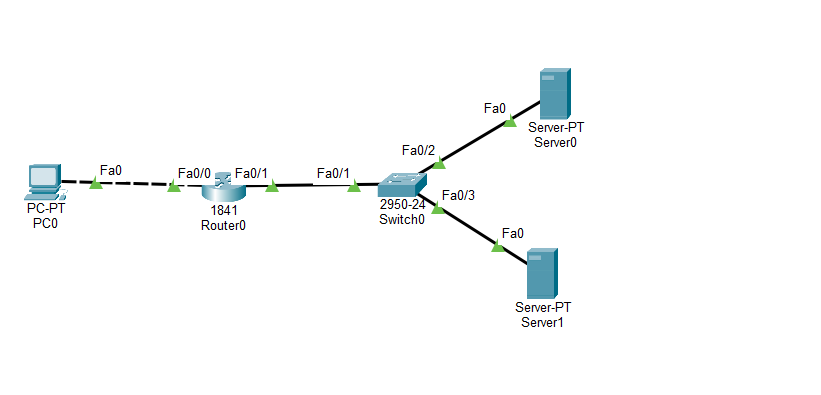
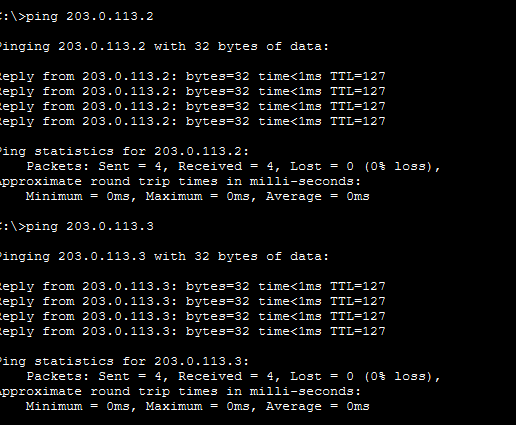

# Билет 10. «HTTP и HTTPS»

## Что надо было сделать

- 1 ПК + коммутатор + роутер + 2 сервера (HTTP и HTTPS).
- Расчёт подсети, gateway.
- ARP, MAC-таблица.
- DHCP.
- NAT/PAT.
- DNS: A-записи для обоих серверов.
- Сравнить HTTP (TCP 80) и HTTPS (TCP 443), посмотреть инкапсуляцию.
- **Отчёт:** чем отличается TCP-сессия HTTP от HTTPS.

## Отчёт

- Схема HTTP и HTTPS в Cisco Packet Tracer



Сеть: ПК → роутер Cisco 1841 → коммутатор 2950-24 → два сервера. ПК подключён кабелем `Copper Cross-Over`, остальные устройства — `Copper Straight-Through`.

[Схема в формате pkt](../assets/final-test/pkt/10_HTTP_HTTPS.pkt)

- Расчёт, как проводился

Выбрана маска `/29` (`255.255.255.248`). Для узлов остаётся `32 − 29 = 3` бита: всего `2³ = 8` адресов, из них `8 − 2 = 6` доступны устройствам.

| Параметр | Сеть ПК | Сеть серверов |
| --- | --- | --- |
| Адрес сети | 192.168.10.0/29 | 203.0.113.0/29 |
| Маска | 255.255.255.248 | 255.255.255.248 |
| Адреса узлов | 192.168.10.1–192.168.10.6 | 203.0.113.1–203.0.113.6 |
| Broadcast | 192.168.10.7 | 203.0.113.7 |
| Шлюз (gateway) | 192.168.10.1, Fa0/0 роутера | 203.0.113.1, Fa0/1 роутера |
| Устройства | ПК: 192.168.10.2 | Server0: 203.0.113.2; Server1: 203.0.113.3 |

- ARP и MAC-таблица



MAC-таблица

- DHCP

На ПК выбран DHCP.

- NAT/PAT

Внутренний интерфейс — `Fa0/0`, внешний — `Fa0/1`. Для сети ПК используется PAT:

```text
access-list 1 permit 192.168.10.0 0.0.0.7
ip nat inside source list 1 interface FastEthernet0/1 overload
```

- DNS

На Server0 включена служба DNS. Для сайтов предусмотрены две A-записи:

| Имя | Тип | IP-адрес |
| --- | --- | --- |
| http.lab.test | A | 203.0.113.2 |
| https.lab.test | A | 203.0.113.3 |

- HTTP, HTTPS и инкапсуляция
Адреса для проверки в браузере ПК: `http://http.lab.test` и `https://https.lab.test`.

| Признак | HTTP | HTTPS |
| --- | --- | --- |
| Транспорт в работе | TCP | TCP |
| Порт сервера | 80 | 443 |
| Установление TCP | SYN → SYN-ACK → ACK | SYN → SYN-ACK → ACK |
| Защита HTTP-данных | Без шифрования | TLS: шифрование и контроль целостности |
| Инкапсуляция | HTTP → TCP → IP → Ethernet | HTTP → TLS → TCP → IP → Ethernet |

- Вывод

В схеме HTTP и HTTPS используют TCP-соединения. HTTP работает через порт 80, HTTPS — через 443. Главное отличие HTTPS — дополнительный TLS-обмен и защита HTTP-данных. DHCP выдаёт параметры ПК, DNS связывает имена серверов с IP-адресами, а PAT преобразует адрес источника при обращении к серверам.
