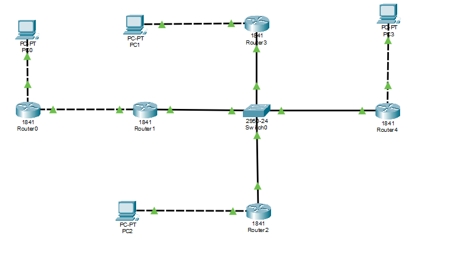

# Домашние задание № 8

## Что надо было сделать 

- Построить в циско схемы из презентации для настройки на следующей паре.

## Решение

1) Статическая маршрутизация

2) Сеть для настройки RIP

3) Примеры RIP, OSPF и BGP.

    Не хватило портов
