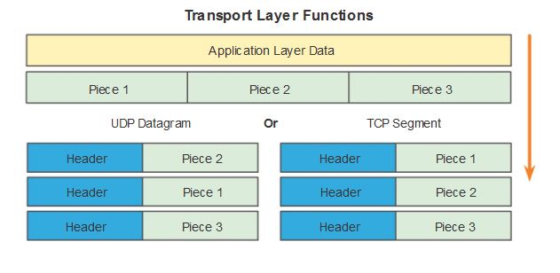
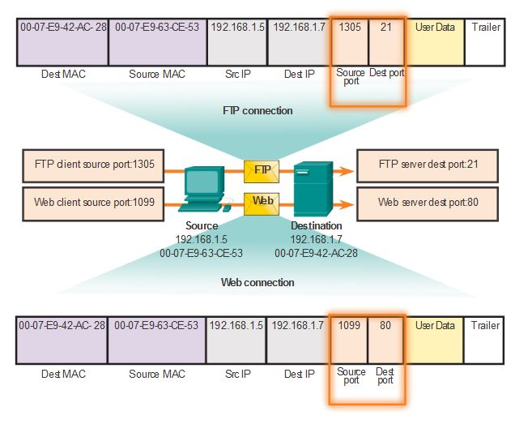
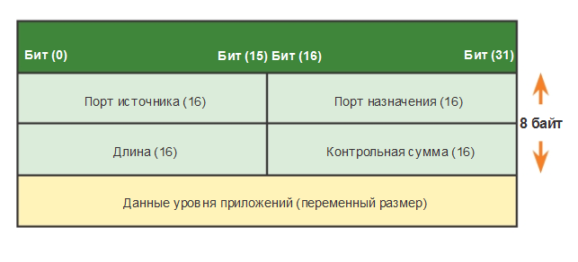
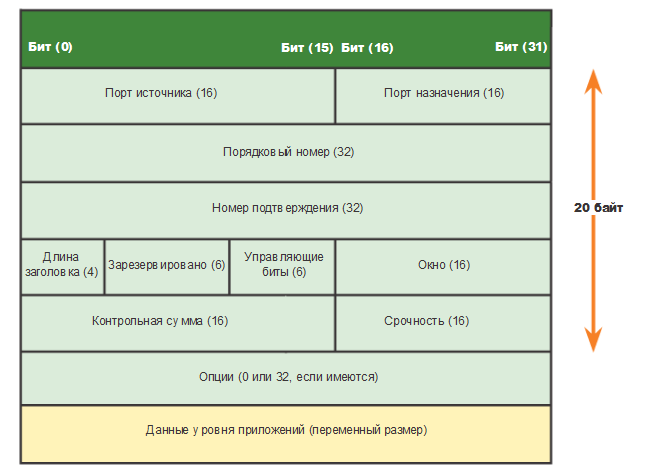
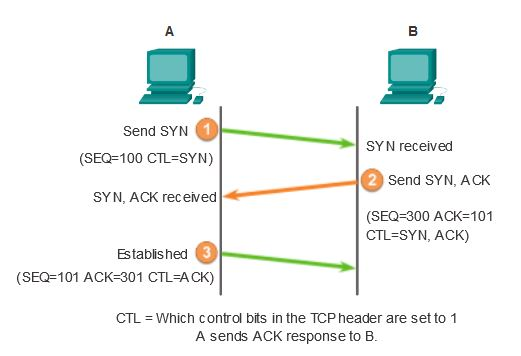
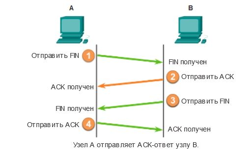
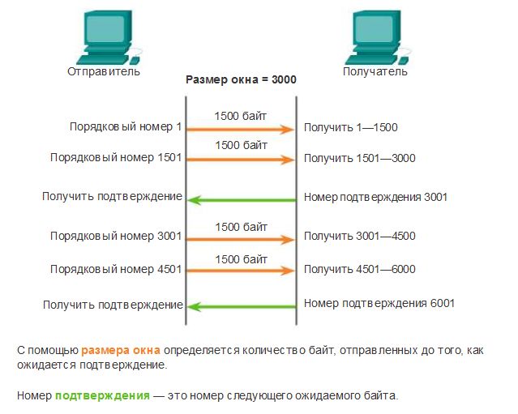
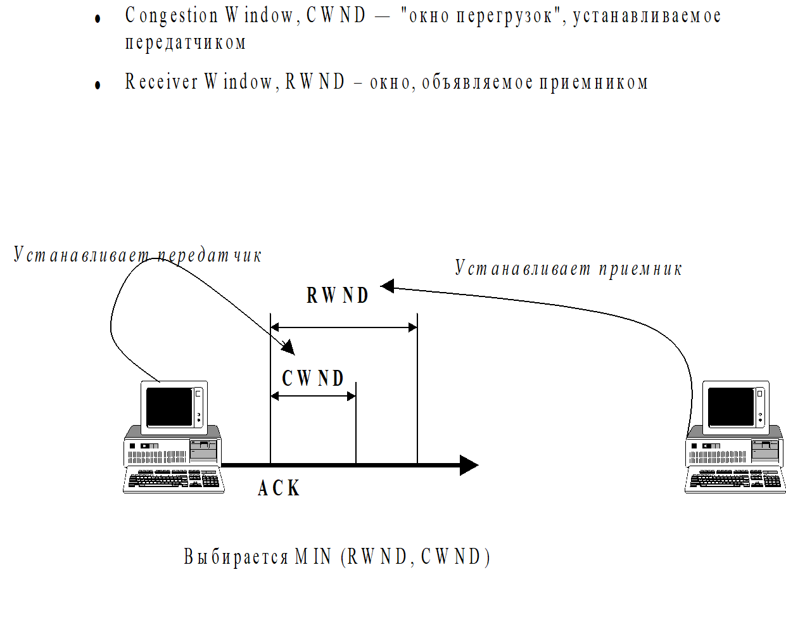
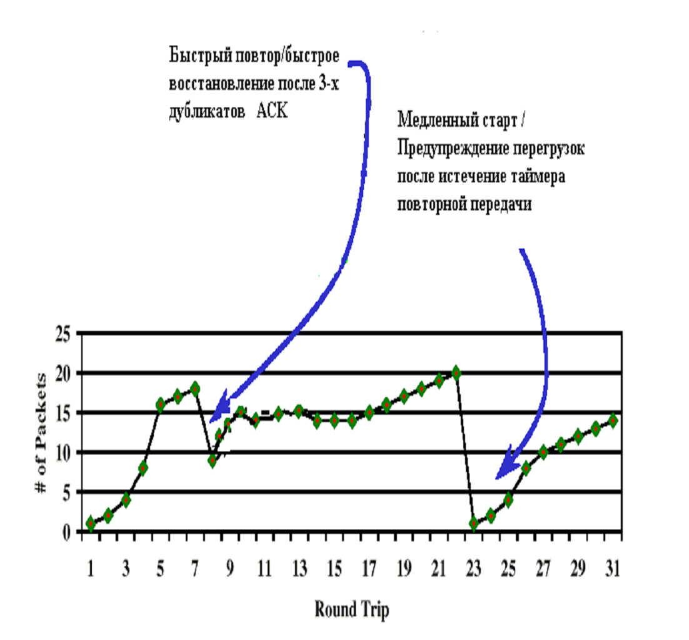

# Транспортный уровень TCP и UDP

Источники: презентации «tcp.udp1», «tcp.udp.2» и «tcp.udp.3».

## Назначение транспортного уровня

**Транспортный уровень** обеспечивает обмен данными между приложениями на разных хостах. В модели OSI это четвёртый уровень, в стеке TCP/IP он находится между прикладным и межсетевым уровнями.

Основные функции:

- разделение данных на части и сборка на стороне получателя;
- адресация приложений с помощью портов;
- передача данных между конечными узлами;
- для TCP — установление соединения, надёжная доставка, восстановление порядка и управление потоком.

Единица данных транспортного уровня — **TPDU**: сегмент TCP или дейтаграмма UDP. IP помещает её в пакет, а канальный уровень — в кадр. Приложения обращаются к транспортному уровню через **интерфейс сокетов**.



## Порты и сокеты

**Порт** — 16-битный номер, который позволяет передать данные нужному приложению. IP-адрес определяет хост, порт — получателя внутри хоста. Пример записи: `192.168.1.3:80`.

| Диапазон | Группа |
| --- | --- |
| 0–1023 | Общеизвестные порты |
| 1024–49151 | Зарегистрированные порты |
| 49152–65535 | Частные и динамические порты |

Стандартные номера регистрирует **IANA**. Сервер обычно слушает известный порт, а клиент получает временный порт от ОС. TCP и UDP имеют отдельные пространства портов.

| Служба | Порт | Транспорт в примерах презентаций |
| --- | --- | --- |
| FTP, управление | 21 | TCP |
| Telnet | 23 | TCP |
| SMTP | 25 | TCP |
| DNS | 53 | UDP или TCP |
| DHCP | 67 — сервер, 68 — клиент | UDP |
| TFTP | 69 | UDP |
| HTTP | 80 | TCP |
| SNMP | 161 | Обычно UDP |

**Сокет** обозначает конечную точку обмена: IP-адрес и порт. TCP-соединение определяется парой сокетов: `(IP клиента, порт клиента)` и `(IP сервера, порт сервера)`. Один серверный сокет может участвовать в нескольких соединениях с разными клиентами.

**Мультиплексирование** объединяет данные разных приложений для передачи через IP. **Демультиплексирование** распределяет поступившие данные по приложениям на основе портов.



## UDP

**UDP (User Datagram Protocol)** — протокол дейтаграмм пользователя. Каждая дейтаграмма переносит отдельное сообщение приложения и сохраняет его границы.

UDP работает без установления соединения. Он не подтверждает получение, не повторяет потерянные данные, не восстанавливает порядок и не управляет потоком. При переполнении входного буфера сообщения могут отбрасываться. Необходимую обработку потерь выполняет приложение.

Преимущество UDP — небольшой заголовок и отсутствие расходов на установление соединения и подтверждения. Он подходит для коротких запросов и ответов, IP-телефонии и потокового видео. В презентациях приведены DNS, DHCP, TFTP и SNMP.

### Заголовок UDP

Заголовок занимает **8 байт** и содержит четыре поля по 16 бит:

- порт отправителя;
- порт получателя;
- длину дейтаграммы, включая заголовок и данные;
- контрольную сумму для обнаружения ошибок.

Номер UDP в поле протокола IP — **17**. В обычном IPv4-пакете с заголовком 20 байт максимальная длина UDP-дейтаграммы составляет 65 515 байт.



## TCP

**TCP (Transmission Control Protocol)** — протокол управления передачей. Он обеспечивает надёжную, упорядоченную передачу **потока байт** между двумя приложениями в обоих направлениях. TCP разбивает поток на сегменты, а получатель собирает его обратно. Границы отдельных сообщений приложения TCP не сохраняет.

Надёжность обеспечивают нумерация байтов, контрольная сумма, подтверждения и повторная передача. TCP обнаруживает дубликаты и восстанавливает порядок данных. При невозможности продолжить обмен соединение завершается с ошибкой.

TCP используют FTP, HTTP, SMTP и также DNS. TCP-соединение связывает две конечные точки и не предназначено для широковещательной или групповой передачи.

### Заголовок TCP

Основной заголовок занимает **20 байт**, с параметрами — до 60 байт.

| Поле | Назначение |
| --- | --- |
| Порты отправителя и получателя | Адресация приложений |
| Порядковый номер, SEQ | Номер первого байта данных сегмента |
| Номер подтверждения, ACK | Номер следующего ожидаемого байта |
| Длина заголовка | Где начинаются данные |
| Управляющие флаги | Управление соединением и обработкой данных |
| Размер окна | Сколько байтов готов принять получатель |
| Контрольная сумма | Обнаружение ошибок в заголовке и данных |
| Указатель срочности | Используется вместе с флагом URG |
| Параметры | Дополнительные возможности TCP |



Основные флаги:

- **SYN** — синхронизация начальных порядковых номеров;
- **ACK** — поле подтверждения имеет значение;
- **FIN** — отправитель закончил передачу данных;
- **RST** — сброс соединения;
- **PSH** — передача принятых данных приложению без дополнительного ожидания;
- **URG** — указатель срочности имеет значение.

Параметры TCP: **MSS** — максимальный объём данных сегмента, масштабирование окна, **SACK** — выборочное подтверждение диапазонов байтов, метки времени.

## Установление и завершение соединения

Перед передачей TCP выполняет **трёхэтапное рукопожатие**:

1. Клиент отправляет **SYN** со своим начальным номером SEQ.
2. Сервер отвечает **SYN + ACK**: сообщает свой SEQ и подтверждает SYN клиента.
3. Клиент отправляет **ACK**, подтверждая SYN сервера. Соединение установлено.

Пример со слайда: клиент отправляет `SEQ=100`, сервер отвечает `SEQ=300, ACK=101`, клиент подтверждает `ACK=301`. SYN занимает один номер последовательности.



При обычном завершении каждая сторона закрывает своё направление передачи: **FIN, ACK, FIN, ACK**. Подтверждение и FIN могут объединяться. Флаг **RST** немедленно сбрасывает соединение.



## Подтверждения и скользящее окно

При методе **остановки и ожидания** отправитель передаёт одну часть данных и ждёт подтверждения. Если оно не приходит до истечения тайм-аута, повторяет передачу. Ожидание после каждой отправки снижает скорость.

TCP использует **скользящее окно**: позволяет отправить несколько сегментов до получения подтверждения. Размер окна измеряется в байтах. После подтверждения окно сдвигается, разрешая отправку новых данных.

**Кумулятивное подтверждение `ACK=X`** означает: все байты с номерами меньше X приняты, следующий ожидаемый байт — X. Например, при окне 3000 байт можно отправить два сегмента по 1500 байт. После получения байтов 1–3000 получатель отвечает `ACK=3001`.

Если часть данных потеряна, ACK продолжает указывать на начало пропуска. **SACK** дополнительно сообщает, какие диапазоны после пропуска уже получены.



Отправитель хранит неподтверждённые данные для повторной передачи. Тайм-аут **RTO** выбирается адаптивно по измерениям **RTT** — времени от отправки данных до получения подтверждения. **SRTT** — сглаженная оценка RTT.

## Управление потоком и перегрузкой

**Управление потоком (flow control)** защищает медленного получателя от быстрого отправителя. Получатель сообщает свободный объём своего буфера через окно **RWND**. По мере заполнения буфера окно уменьшается.

При окне **0** отправитель приостанавливает передачу новых данных и периодически проверяет открытие окна с помощью **Zero Window Probe**.

**Управление перегрузкой (congestion control)** ограничивает нагрузку на сеть. Отправитель поддерживает окно перегрузки **CWND**. Объём неподтверждённых данных ограничивает меньшее из двух окон: `min(RWND, CWND)`.



Сигналами перегрузки могут быть потери, рост задержки и явное уведомление маршрутизатора. Если многие отправители одновременно уменьшают окна после потерь, а затем одновременно увеличивают передачу, возникает **глобальная синхронизация TCP**.

Классические алгоритмы из третьей презентации:

| Алгоритм | Основная идея |
| --- | --- |
| **Slow Start**, медленный старт | Начать с небольшого CWND и быстро увеличивать его по подтверждениям, примерно удваивая за RTT до порога SSThresh |
| **Congestion Avoidance**, предупреждение перегрузок | После достижения порога увеличивать окно осторожнее, примерно на один MSS за RTT |
| **Fast Retransmit**, быстрый повтор | После трёх дублирующих ACK повторить предполагаемый потерянный сегмент, не дожидаясь тайм-аута |
| **Fast Recovery**, быстрое восстановление | Уменьшить окно и продолжить обмен без полного возврата к начальному медленному старту |

В примере при истечении таймера порог уменьшается примерно вдвое, CWND возвращается к начальному значению, затем снова работает медленный старт.



## Сравнение TCP и UDP

| Свойство | TCP | UDP |
| --- | --- | --- |
| Соединение | Устанавливается перед обменом | Не требуется |
| Данные | Поток байт | Отдельные дейтаграммы |
| Подтверждения и повторная передача | Есть | Нет |
| Восстановление порядка | Есть | Нет |
| Управление потоком и перегрузкой | Есть | Нет |
| Заголовок | 20–60 байт | 8 байт |
| Накладные расходы | Выше | Ниже |

## Проверка соединений и портов

Команда **netstat** показывает сетевые соединения и слушающие порты. Проверить возможность TCP-подключения можно через Telnet:

```text
netstat -an
telnet 192.168.1.100 80
```

Telnet проверяет подключение к TCP-порту. Доступность UDP-порта таким способом не проверяется.
