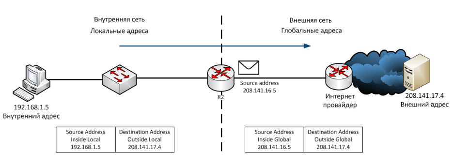
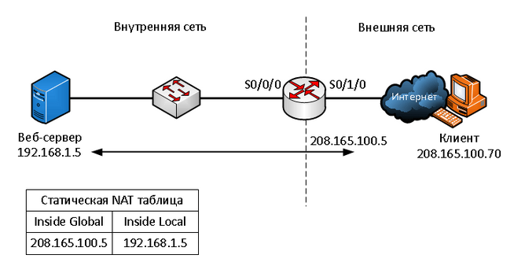
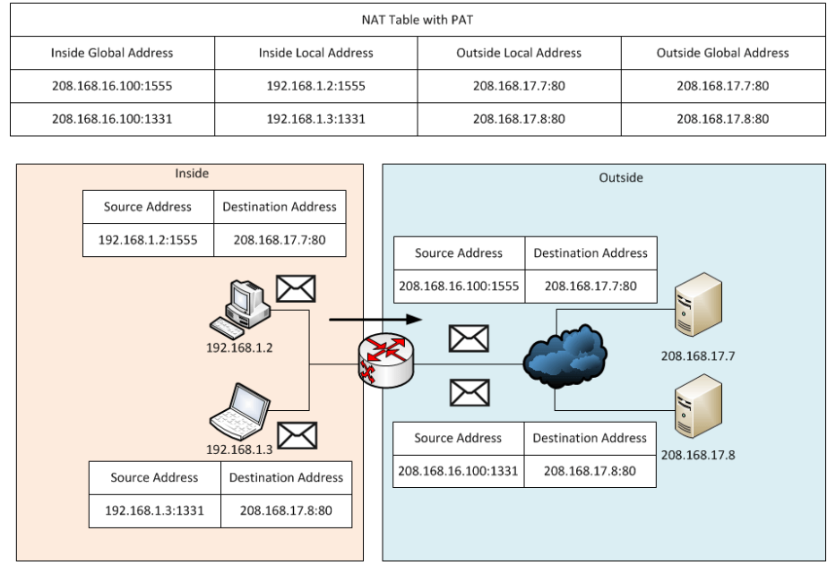

# Технология NAT

## Назначение NAT

**NAT (Network Address Translation)** — технология преобразования IP-адресов. При выходе в Интернет маршрутизатор заменяет частный адрес устройства публичным. Это помогает экономить IPv4-адреса, особенно при использовании PAT.

Частные диапазоны IPv4:

- `10.0.0.0/8`;
- `172.16.0.0/12`;
- `192.168.0.0/16`.

Их используют внутри сетей, в Интернете они не маршрутизируются. **Пул NAT** — набор публичных адресов, доступных для трансляции.

NAT обычно работает на пограничном маршрутизаторе. **Stub-сеть** — тупиковая сеть с единственным выходом в соседнюю сеть. Долгосрочное решение нехватки IPv4-адресов — переход на IPv6.

## Адреса в NAT

**Inside / Outside** обозначают принадлежность устройства внутренней или внешней сети. **Local / Global** показывают, как его адрес виден внутри или снаружи.

| Обозначение | Значение | Пример |
| --- | --- | --- |
| **Inside local** | Адрес внутреннего устройства во внутренней сети | `192.168.1.5` |
| **Inside global** | Адрес этого устройства, видимый во внешней сети | `208.141.16.5` |
| **Outside local** | Адрес внешнего устройства, видимый из внутренней сети | `208.141.17.4` |
| **Outside global** | Адрес внешнего устройства во внешней сети | `208.141.17.4` |

Обычно Outside local и Outside global совпадают: адрес внешнего сервера не меняется.



### Прохождение пакета

1. ПК `192.168.1.5` отправляет пакет серверу `208.141.17.4`.
2. Маршрутизатор заменяет адрес источника на `208.141.16.5` и хранит соответствие в **таблице NAT**.
3. Сервер отвечает на адрес `208.141.16.5`.
4. Маршрутизатор находит запись в таблице, заменяет адрес назначения на `192.168.1.5` и передаёт ответ ПК.

## Виды NAT

| Вид | Как работает | Применение |
| --- | --- | --- |
| **Static NAT** | Постоянное соответствие одного частного адреса одному публичному | Доступ к внутреннему серверу из Интернета |
| **Dynamic NAT** | Временное соответствие одному свободному адресу из пула | Выход внутренних устройств во внешнюю сеть |
| **PAT (NAT Overload)** | Несколько устройств используют один или несколько публичных адресов. Соединения различаются по портам | Совместный выход в Интернет |

**Статический NAT:** соответствия задаёт администратор, они постоянно находятся в таблице. Каждому публикуемому устройству нужен отдельный публичный адрес.



**Динамический NAT:** маршрутизатор выделяет свободный адрес при появлении трафика. Одновременно каждому транслируемому внутреннему адресу нужен отдельный адрес из пула. После истечения времени неактивности запись удаляется, адрес освобождается. Если пул занят, новое устройство не сможет получить трансляцию до освобождения адреса.

Пример распределения пула:

| Inside local | Inside global |
| --- | --- |
| `192.168.1.10` | `208.165.100.5` |
| `192.168.2.10` | `208.165.100.6` |

### Работа PAT

PAT учитывает IP-адреса и номера портов TCP или UDP. Маршрутизатор старается сохранить исходный порт, а при конфликте назначает свободный.

Например, два ПК используют порт `1444`:

| До трансляции | После трансляции |
| --- | --- |
| `192.168.1.10:1444` | `208.165.99.225:1444` |
| `192.168.2.10:1444` | `208.165.99.225:1445` |

По записи в таблице PAT маршрутизатор возвращает ответ нужному ПК, восстанавливая его адрес и исходный порт. Для эхо-запросов ICMP, у которых нет портов TCP/UDP, PAT использует идентификатор запроса.



## Преимущества и недостатки

**Преимущества:** экономия публичных IPv4-адресов при PAT, сохранение внутренней адресации при смене провайдера, скрытие частных адресов от внешней сети. NAT не заменяет межсетевой экран.

**Недостатки:** дополнительная обработка пакетов и задержки, нарушение сквозной адресации, усложнение диагностики. Возможны трудности с VoIP, IPsec и входящими соединениями без заранее настроенного сопоставления.

## Основные команды Cisco IOS

### Внутренний и внешний интерфейсы

Для всех вариантов NAT указывают интерфейсы относительно границы сети. В примерах презентации `Serial0/0/0` — внутренний, `Serial0/1/0` — внешний:

```text
Router(config)# interface serial0/0/0
Router(config-if)# ip nat inside
Router(config-if)# exit
Router(config)# interface serial0/1/0
Router(config-if)# ip nat outside
Router(config-if)# exit
```

### Статический NAT

Постоянное сопоставление адреса внутреннего сервера с публичным:

```text
Router(config)# ip nat inside source static 192.168.1.5 208.165.100.5
```

### Динамический NAT

Создают пул, задают разрешённые для трансляции адреса через **ACL** и связывают ACL с пулом:

```text
Router(config)# ip nat pool NAT_POOL 208.165.100.5 208.165.100.15 netmask 255.255.255.0
Router(config)# access-list 1 permit 192.168.0.0 0.0.255.255
Router(config)# ip nat inside source list 1 pool NAT_POOL
```

ACL 1 выбирает адреса сети `192.168.0.0/16`. `0.0.255.255` — wildcard-маска: нулевые биты проверяются, единичные могут иметь любое значение.

### PAT

Для PAT с пулом к команде привязки добавляют **overload**:

```text
Router(config)# ip nat inside source list 1 pool NAT_POOL overload
```

Для PAT с одним публичным адресом используют адрес внешнего интерфейса. ACL и обозначения интерфейсов остаются такими же:

```text
Router(config)# ip nat inside source list 1 interface serial0/1/0 overload
```

### Проверка и очистка

| Команда | Назначение |
| --- | --- |
| `show ip nat translations` | Показать таблицу трансляций |
| `show ip nat translations verbose` | Показать подробности записей |
| `show ip nat statistics` | Показать статистику, интерфейсы и использование пула |
| `show access-lists` | Проверить ACL |
| `clear ip nat statistics` | Сбросить статистику перед проверкой |
| `clear ip nat translation *` | Удалить динамические трансляции. Активные сеансы могут прерваться |

Статические сопоставления удаляют из конфигурации командой `no ip nat inside source static` с теми же адресами. Динамические записи появляются при прохождении подходящего трафика.
