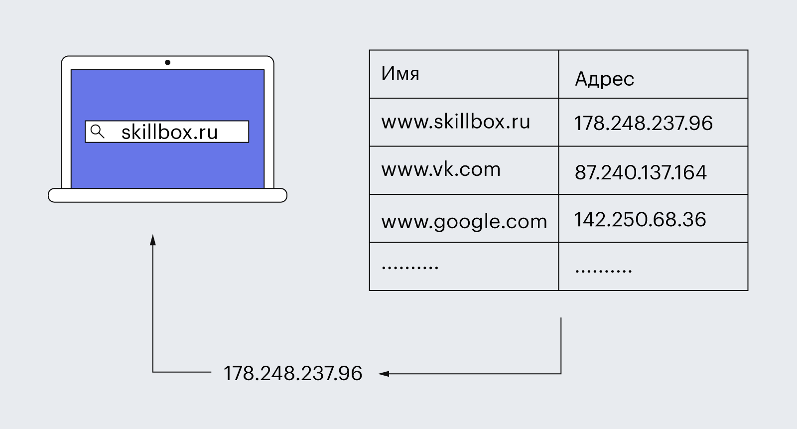
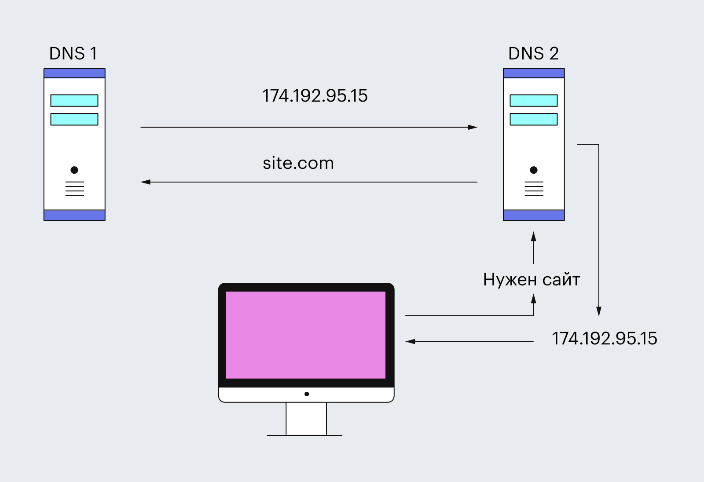
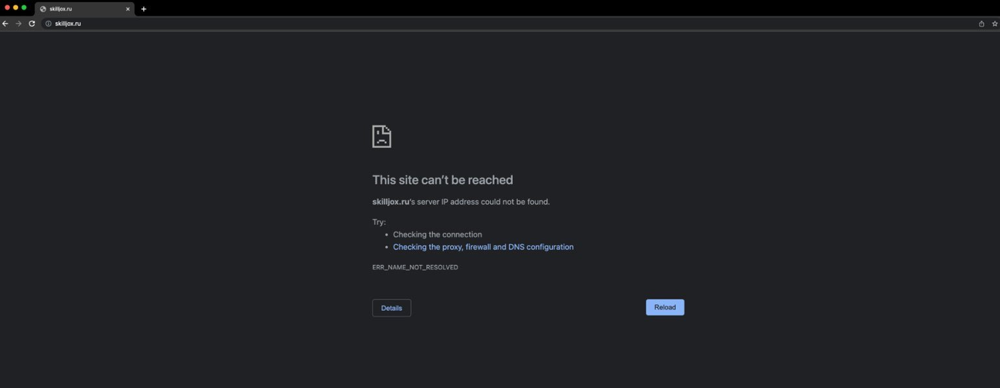
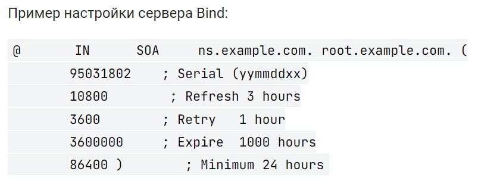

# Система доменных имён DNS

## Назначение DNS

**DNS (Domain Name System)** — распределённая система доменных имён. Она помогает узнать IP-адрес по имени сайта. Имя удобно запоминать человеку, а IP-адрес нужен компьютеру для подключения.

Раньше соответствия имён и адресов хранили в общем файле `HOSTS.TXT`. С ростом сети поддерживать его стало неудобно, поэтому появилась DNS.

DNS похожа на телефонную книгу: пользователь вводит имя, а система находит нужный адрес.

*IP-адреса на схемах — примеры из презентации, они могут меняться.*

## DNS-серверы и поиск адреса

**DNS-серверы** хранят записи о доменах и отвечают на запросы. Каждый обслуживает свою часть системы или временно сохраняет ответы других серверов.

- **Рекурсивный сервер (резолвер)** ищет ответ для клиента. Его может предоставлять провайдер или публичная DNS-служба.
- **Корневые серверы** указывают серверы доменов верхнего уровня, например `.ru` или `.com`.
- **Серверы верхнего уровня** направляют запрос к серверам нужного домена.
- **Авторитетный сервер** хранит записи своей зоны и возвращает ответ о домене.

Если готового ответа нет в кэше, поиск проходит так:

1. Пользователь вводит имя сайта в браузере.
2. Компьютер проверяет локальные источники: файл `hosts` и DNS-кэш. В `hosts` соответствия задают вручную.
3. Запрос поступает настроенному DNS-резолверу.
4. Резолвер обращается к корневому серверу, серверу верхнего уровня и авторитетному серверу домена.
5. Полученный IP-адрес возвращается клиенту. Браузер подключается к веб-серверу и загружает страницу.

Если домен не существует или адрес получить не удалось, браузер сообщает об ошибке.

## Кэширование и устройство системы

**Кэширование** — временное сохранение DNS-ответов. Оно ускоряет повторные запросы и снижает нагрузку на серверы.

**TTL (Time To Live)** задаёт время хранения записи в кэше. После его истечения ответ нужно обновить. При смене IP-адреса клиенты некоторое время могут получать старый адрес, пока действует кэш.

Основные свойства DNS:

- **Распределённое управление и хранение:** разные организации отвечают за свои части системы.
- **Иерархия:** домены образуют дерево, ответственность за поддомены можно передавать другим серверам.
- **Резервирование:** несколько серверов обслуживают одну зону для надёжности.

Корневые серверы имеют **13 имён**, за которыми стоят многочисленные экземпляры по всему миру. Они хранят сведения о корневой зоне и делегировании доменов верхнего уровня. [IANA](https://www.iana.org/domains/root/servers)

## DNS-зона и записи

**DNS-зона** — часть пространства доменных имён, за которую отвечает определённый набор DNS-серверов. Данные в ней хранятся в виде ресурсных записей.

| Запись | Назначение |
| --- | --- |
| **A** | IPv4-адрес для доменного имени |
| **MX** | Имя почтового сервера домена |
| **CNAME** | Псевдоним, который ссылается на другое доменное имя |
| **NS** | Имя авторитетного DNS-сервера зоны |
| **TXT** | Текстовые сведения, например параметры проверки почты |
| **SOA** | Основные сведения о зоне и параметры её обновления |

**SPF** определяет, какие серверы могут отправлять почту от имени домена. Эти правила публикуют в записи **TXT**. [RFC 7208](https://www.rfc-editor.org/rfc/rfc7208.html#section-3.1)

### Запись SOA

**SOA (Start Of Authority)** содержит данные, необходимые для управления зоной и синхронизации её копий.

| Поле | Значение |
| --- | --- |
| **Primary Name Server** | Имя первичного DNS-сервера зоны |
| **Hostmaster** | Контакт администратора: вместо `@` используют точку |
| **Serial** | Номер версии зоны, который меняют при обновлении |
| **Refresh** | Интервал проверки обновлений вторичным сервером |
| **Retry** | Интервал повторной попытки после неудачной проверки |
| **Expire** | Срок без успешного обновления, после которого вторичный сервер перестаёт обслуживать зону |
| **Minimum** | Параметр времени кэширования отрицательных ответов, например об отсутствии имени |

Временные интервалы задаются в секундах. Поле `Minimum` участвует в определении TTL отрицательного ответа. [RFC 2308](https://www.rfc-editor.org/rfc/rfc2308.html#section-5)

## Уровни доменных имён

Доменное имя состоит из частей, разделённых точками. Уровни читают **справа налево**.

| Уровень | Пример в `go.skillbox.ru.` |
| --- | --- |
| Нулевой, корневой | Последняя точка `.` — обычно её не пишут |
| Первый, верхний | `ru` |
| Второй | `skillbox` |
| Третий, поддомен | `go` |

Домены верхнего уровня бывают **национальными (ccTLD)**, например `.ru`, `.de`, `.uk`, и **общими (gTLD)**, например `.com`, `.org`, `.info`.

`skillbox.ru` и `skillbox.com` — разные доменные имена. Поддомены помогают разделять ресурсы: например, `ru.wikipedia.org` и `en.wikipedia.org` обозначают языковые разделы. Возможны четвёртый и последующие уровни.

## DNS как протокол

DNS работает на **прикладном уровне OSI**. Протокол задаёт правила обмена запросами и ответами, а серверы хранят и предоставляют записи.

**DNSSEC** — расширения DNS для проверки подлинности и целостности данных. Они помогают обнаруживать подмену DNS-ответов.

Основа конспекта и иллюстраций: презентация «DNS (1)». Порядок поиска и устройство DNS уточнены по [RFC 1034](https://www.rfc-editor.org/rfc/rfc1034.html).
