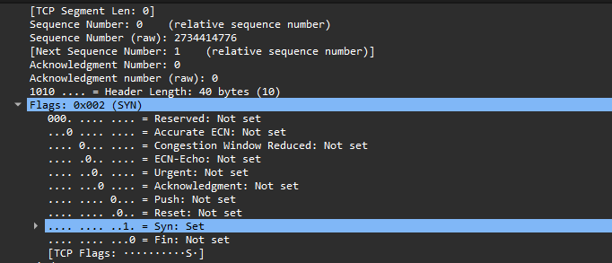
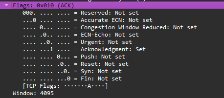
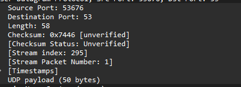

# Домашние задание № 14

## Что надо было сделать

Вам потребуется прислать 3 скриншот из wireshark

* где на 2-х tcp с разными флагами

* а на 3 udp

## Рещение

1) TCP по фильтру `tcp.flags.syn == 1 && tcp.flags.ack == 0` 

2) TCP по фильтру `tcp.flags.ack == 1 && tcp.flags.syn == 0` 

3) UDP 

